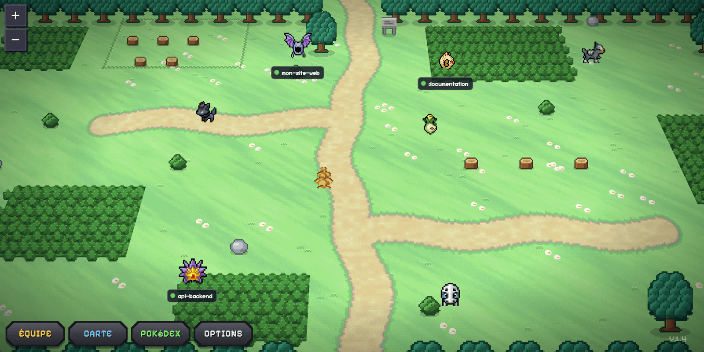
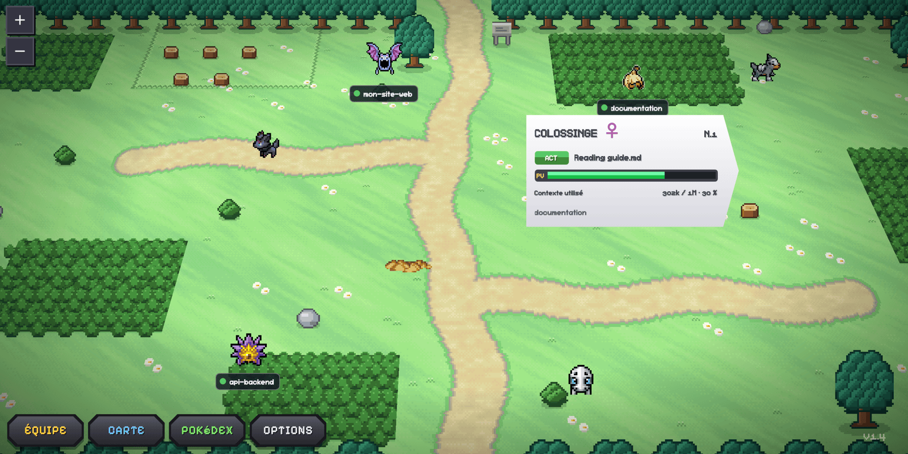
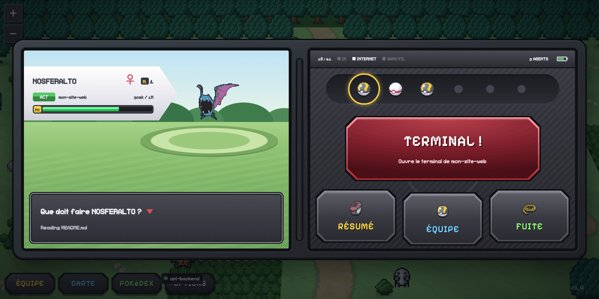
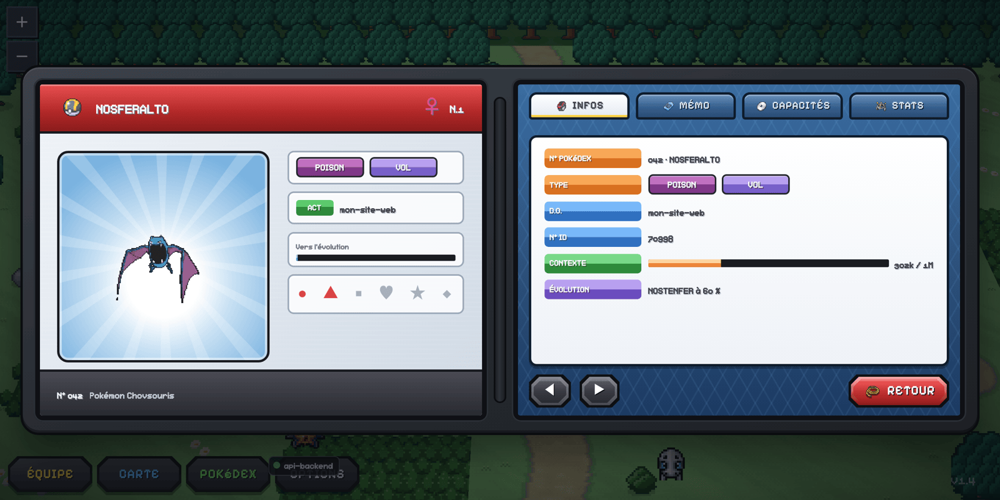
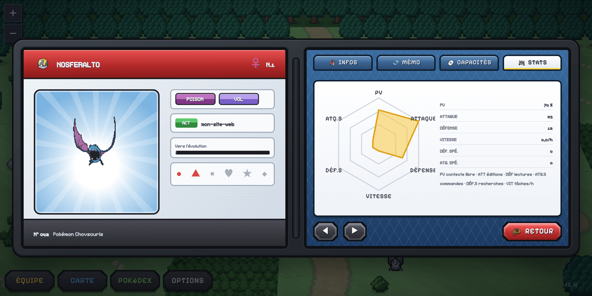
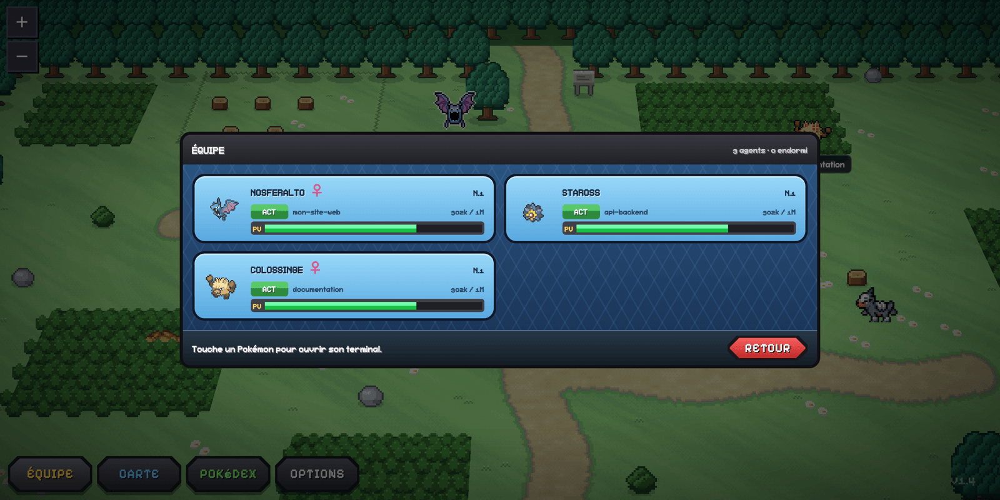
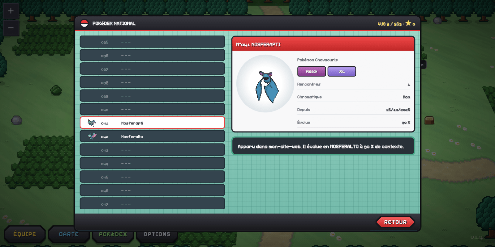

<h1 align="center">PokeAgents</h1>

<p align="center">
  🇬🇧 <a href="README.md">English</a> ·
  🇫🇷 <a href="README.fr.md">Français</a> ·
  🇪🇸 <a href="README.es.md">Español</a> ·
  🇩🇪 <a href="README.de.md">Deutsch</a> ·
  🇮🇹 <a href="README.it.md">Italiano</a> ·
  <strong>🇧🇷 Português</strong> ·
  🇯🇵 <a href="README.ja.md">日本語</a> ·
  🇨🇳 <a href="README.zh-CN.md">简体中文</a>
</p>

<p align="center"><strong>Seus agentes do Claude Code viram criaturas em pixel art trabalhando numa rota, no estilo dos jogos de DS.</strong></p>

<p align="center">
  <a href="#instalação">Instalação</a> •
  <a href="#primeiros-passos">Primeiros passos</a> •
  <a href="#o-que-você-vê">O que você vê</a> •
  <a href="#configurações">Configurações</a> •
  <a href="#desenvolvimento">Desenvolvimento</a> •
  <a href="#créditos-e-avisos-legais">Créditos e avisos legais</a>
</p>

<p align="center">
  
</p>

> **Projeto de fã não oficial.** O PokeAgents não é afiliado, endossado nem patrocinado pela Nintendo, Creatures Inc., GAME FREAK inc. ou The Pokémon Company, nem pela Anthropic. Pokémon e os nomes dos personagens são marcas de seus respectivos donos. O repositório não contém nenhuma imagem tirada dos jogos. Veja [Créditos e avisos legais](#créditos-e-avisos-legais).

## O que é?

O PokeAgents é uma extensão do VS Code (e um pequeno servidor independente) que mostra cada sessão do [Claude Code](https://claude.com/claude-code) como uma criatura numa rota em pixel art:

- **Cada agente tem seu próprio Pokémon**, sorteado e diferente a cada dia. As espécies raras também são raras aqui, e um em cada 64 agentes é brilhante (shiny).
- **Ele evolui conforme o contexto vai enchendo**: primeira evolução com 30% do contexto, segunda com 60%.
- **Ele se move de acordo com o que está fazendo**: lê a placa da rota, vasculha o mato alto, corta uma árvore ou quebra uma rocha.
- **Ele dorme enquanto espera.** Você vê num relance quem está trabalhando, quem terminou e quem está esperando sua resposta.
- **Um clique abre a tela de batalha dele**, com um resumo da sessão: contexto, ferramentas usadas, registro e atributos.
- **Criaturas selvagens** passeiam pela rota e às vezes vêm visitar seus agentes.

O PokeAgents é um fork do [Pixel Agents](https://github.com/pixel-agents-hq/pixel-agents) (licença MIT), que mostrava os agentes num escritório.

## Instalação

### Pré-requisitos

- **VS Code 1.105** ou mais recente.
- **Claude Code** instalado e conectado: `npm install -g @anthropic-ai/claude-code` e depois `claude` uma primeira vez.
- **Node.js 20** ou mais recente, só para instalar a partir do código-fonte ou usar o servidor independente.
- Uma **conexão com a Internet**: os sprites das criaturas são baixados no primeiro uso e depois ficam em cache em `~/.pokeagents/pokemon`.

### Opção 1 — Pelo VS Code Marketplace (recomendado)

No VS Code, abra a visualização **Extensões**, pesquise "PokeAgents" e clique em **Install**. Ou pela linha de comando: `code --install-extension akinaru.pokeagents`. Página da extensão: [VS Code Marketplace](https://marketplace.visualstudio.com/items?itemName=akinaru.pokeagents).

### Opção 2 — A partir de um arquivo `.vsix`

1. Baixe o `pokeagents-x.y.z.vsix` mais recente nas [Releases do GitHub](https://github.com/Akinaru/PokeAgents/releases).
2. Instale:
   ```bash
   code --install-extension pokeagents-x.y.z.vsix
   ```
   Ou no VS Code: visualização **Extensões** → menu **⋯** → **Install from VSIX…**
3. Recarregue a janela se o VS Code pedir.

### Opção 3 — A partir do código-fonte

```bash
git clone https://github.com/Akinaru/PokeAgents.git
cd PokeAgents
npm install
npm run package                 # build de produção
npx @vscode/vsce package        # cria pokeagents-x.y.z.vsix
code --install-extension pokeagents-*.vsix
```

Para testar sem instalar: abra a pasta no VS Code e pressione **F5**. Uma janela "Extension Development Host" se abre com o PokeAgents carregado.

### Opção 4 — Servidor independente (navegador)

Para acompanhar seus agentes fora do VS Code (tmux, terminal puro, outro editor):

```bash
npm install && npm run compile
node dist/cli.js --port 3100
```

Abra o endereço exibido (`http://127.0.0.1:3100/?token=…`). **Guarde esse endereço só para você**: o token que ele contém permite alterar suas configurações do Claude Code.

## Primeiros passos

1. Abra a paleta de comandos (`Cmd+Shift+P` no macOS, `Ctrl+Shift+P` nos outros sistemas) e execute **PokeAgents: Show Panel**. O painel se abre na parte de baixo do VS Code.
2. Na primeira execução, um guia apresenta a interface. Ele oferece ativar a **detecção instantânea**: o PokeAgents então adiciona hooks em `~/.claude/settings.json` para saber em tempo real o que seus agentes estão fazendo.
   - O guia mostra tudo o que será alterado antes de pedir sua autorização.
   - Se você recusar, o PokeAgents lê os transcripts do Claude Code. Também funciona, com um pouco de atraso.
   - Nas configurações, você pode ativar ou remover os hooks a qualquer momento.
3. Inicie um agente:
   - com a **Poké Ball "+ Agent"** da barra inferior, que abre um terminal do Claude Code;
   - ou executando `claude` em qualquer terminal do projeto.
4. O Pokémon dele aparece num toco e depois vai trabalhar quando o agente usa suas ferramentas.

## O que você vê

A interface do painel está, por enquanto, em francês. Os rótulos abaixo aparecem exatamente como na tela, com o significado em português entre parênteses.

### A rota

Cada agente tem uma etiqueta com o nome do projeto e um selo de estado:

| Estado   | Significado                                                                    |
| -------- | ------------------------------------------------------------------------------ |
| **ACT**  | Ativo: o agente está trabalhando.                                              |
| **ATT**  | Aguardando (_attente_): ele precisa da sua permissão para usar uma ferramenta. |
| **FINI** | Finalizado: ele acabou de concluir a tarefa.                                   |
| **SOM**  | Dormindo (_sommeil_): ele não está fazendo nada; o Pokémon dorme no lugar.     |

Um agente trabalhando muda de posto a cada 10 a 20 segundos. O posto depende da ferramenta que ele está usando:

| Ferramenta do agente             | O que o Pokémon dele faz            |
| -------------------------------- | ----------------------------------- |
| Leitura de arquivos              | Lê a placa da rota.                 |
| Busca (Grep, Glob, busca na web) | Vasculha o mato alto ou um arbusto. |
| Edição de arquivos               | Corta uma árvore.                   |
| Comando no terminal              | Quebra uma rocha.                   |

Os agentes sempre ficam dentro da visão inicial da câmera, bem afastados uns dos outros, para continuarem clicáveis e legíveis.

### O cartão ao passar o mouse

<p align="center"></p>

Passe o mouse sobre um Pokémon para ver o nome, o nível (uma tarefa concluída = um nível), o que ele está fazendo e a barra de PS (indicada como **PV**). **Os PS são o contexto ainda livre**: quando a barra fica vermelha, a sessão está chegando ao limite.

### A tela de batalha

<p align="center"></p>

Clique num Pokémon para abrir a tela de batalha dele:

- **TERMINAL !** abre o terminal do agente. O botão vira **RÉPONDRE !** (RESPONDER!) quando o agente está esperando sua permissão.
- As **Poké Balls** no topo permitem passar de um agente para outro. Uma Ball apagada indica um agente dormindo; uma Ball tremendo, um agente aguardando.
- **RÉSUMÉ** (RESUMO) abre o resumo, **ÉQUIPE** (EQUIPE) a lista de agentes e **FUITE** (FUGIR) fecha a tela (ou `Esc`).

### O resumo

<p align="center">
  
  
</p>

Quatro abas, e ◀ ▶ para trocar de agente:

- **INFOS** (INFORMAÇÕES): número da Pokédex, tipos, projeto, contexto usado, próxima evolução.
- **MÉMO** (NOTAS): a natureza dele, deduzida das ferramentas favoritas, e o registro das ações.
- **CAPACITÉS** (GOLPES): Edição, Leitura, Comando e Busca, com o número de usos.
- **STATS** (ATRIBUTOS): PV (PS) = contexto livre, ATTAQUE (ATAQUE) = edições, DÉFENSE (DEFESA) = leituras, ATQ. SPÉ. (AT. ESP.) = comandos, DÉF. SPÉ. (DEF. ESP.) = buscas, VITESSE (VELOCIDADE) = tarefas por hora.

Golpes, registro e atributos contam o que acontece enquanto o painel está aberto. Eles voltam a zero quando você recarrega o painel.

### Equipe e Pokédex

<p align="center">
  
  
</p>

- **ÉQUIPE** (EQUIPE) lista todos os seus agentes com estado e PS. Um clique abre o terminal do agente.
- **POKéDEX** guarda cada espécie encontrada, com a data, o projeto e o número de encontros. Ela é salva em `~/.pokeagents/pokedex.json`.

## Configurações

O botão **OPTIONS** abre as configurações:

| Configuração              | Efeito                                                                |
| ------------------------- | --------------------------------------------------------------------- |
| Sound Notifications       | Bipes curtos de menu quando um agente termina ou está aguardando.     |
| Instant Detection (Hooks) | Instala ou remove os hooks do Claude Code.                            |
| Watch All Sessions        | Acompanha também sessões do Claude Code iniciadas fora deste projeto. |
| Always Show Labels        | Mostra sempre o cartão de cada agente.                                |

Os arquivos do PokeAgents ficam em `~/.pokeagents/`: configurações, mapa, Pokédex e cache de sprites. Para zerar tudo, feche o VS Code e apague essa pasta. Para remover os hooks, desmarque **Instant Detection** antes de desinstalar. Desinstalar a extensão também os remove.

### Visual Preto/Branco local (opcional)

Se você tem suas próprias texturas de mapa dos jogos, pode usá-las **somente na sua máquina**:

1. Coloque as texturas `matrix1_*.png` em `tmp/bw/matrix1/`. Essa pasta é ignorada pelo git.
2. Execute `npx tsx scripts/build-bw-pack.ts`.

O script cria um pack em `~/.pokeagents/packs/pokemon-bw` e o ativa. Esses arquivos nunca devem ser adicionados ao repositório nem compartilhados.

## Desenvolvimento

```bash
npm install          # instala todo o monorepo
npm run compile      # gera o protocolo, verifica os tipos, lint, build
npm test             # testes do servidor e da interface
npm run e2e          # testes de ponta a ponta (Playwright)
```

- **F5** no VS Code abre uma janela de desenvolvimento com a extensão.
- `npx tsx scripts/generate-route-assets.ts` regenera o mapa e seus cenários, desenhados por script.
- `npx tsx scripts/generate-pokedex.ts` regenera os dados das espécies.

A arquitetura (servidor, protocolo, interface) está descrita em [CLAUDE.md](CLAUDE.md) e [CONTRIBUTING.md](CONTRIBUTING.md).

## Créditos e avisos legais

O PokeAgents é um **projeto de fã gratuito e sem fins comerciais**.

- **Pokémon** © Nintendo, Creatures Inc. e GAME FREAK inc. Pokémon e os nomes dos personagens são marcas da Nintendo. O PokeAgents não é afiliado a essas empresas nem aprovado por elas. O repositório e a extensão não contêm nenhuma imagem extraída dos jogos.
- **Cenário da rota**: o mapa, as árvores, o mato e os tocos são desenhados pelos scripts do repositório.
- **Sprites das criaturas**: baixados em tempo de execução, nunca armazenados no repositório.
  - Sprites de movimento: [PMDCollab SpriteCollab](https://github.com/PMDCollab/SpriteCollab), de seus colaboradores, sob a licença [CC BY-NC 4.0](https://creativecommons.org/licenses/by-nc/4.0/). Essa licença proíbe qualquer uso comercial do PokeAgents.
  - Sprites animados, ícones e itens: repositório [PokeAPI/sprites](https://github.com/PokeAPI/sprites).
- **Dados das espécies**: [PokeAPI](https://pokeapi.co/).
- **Fonte**: [Pixelify Sans](https://github.com/eifetx/Pixelify-Sans), © 2021 The Pixelify Sans Project Authors, sob a SIL Open Font License 1.1.
- **Base do projeto**: [Pixel Agents](https://github.com/pixel-agents-hq/pixel-agents), © 2026 Pablo De Lucca, licença MIT. Os personagens humanos originais são inspirados no [pack Metro City de JIK-A-4](https://jik-a-4.itch.io/metrocity-free-topdown-character-pack).
- **Claude Code** é um produto da Anthropic. O PokeAgents não é afiliado à Anthropic.

Os detalhes das licenças de terceiros estão em [THIRD_PARTY_NOTICES.md](THIRD_PARTY_NOTICES.md).

### Licença

O código do PokeAgents está sob a [licença MIT](LICENSE). Essa licença cobre apenas o código. Ela não dá nenhum direito sobre as marcas e personagens Pokémon, nem sobre os sprites de terceiros, que mantêm suas próprias licenças.

Você é detentor de direitos e quer que algum item seja removido? [Abra uma issue](https://github.com/Akinaru/PokeAgents/issues) e ele será removido rapidamente.
